# Analisis Proses Bisnis: Bank Sampah Digital Desa

> Konversi dari `Analisis_Proses_Bisnis_Bank_Sampah_Digital_Desa.docx` ke Markdown. Seluruh diagram yang semula berupa gambar (alur bisnis, use case, activity, sequence, ERD, peta navigasi, wireframe) ditulis ulang sebagai Mermaid atau teks agar bisa dibaca AI agent.

## Panduan untuk AI Agent (baca dulu)

Dokumen ini mengandung DUA sistem berbeda. Jangan tertukar.

| | Sistem berjalan | Sistem usulan (yang dirancang) |
| --- | --- | --- |
| Nama | e-Bank Sampah Jakarta | **Bank Sampah Digital Desa** |
| Status | Sudah ada (milik DLH DKI Jakarta), hanya dianalisis di bagian 1 | Rancangan baru milik penulis, bagian 2 sampai 9 |
| Peran | Nasabah, BSU, BSI, Offtaker, Sudin/Satpel, Dinas | Nasabah, Pengelola, Kepala Desa, Admin (Pengepul = pihak eksternal tanpa login) |

Fakta kunci aplikasi yang dirancang (sumber kebenaran: bagian 2.5 Aturan bisnis, 3 Kebutuhan, 7 Struktur database):

1. Skala: satu desa, satu bank sampah. Skema tetap membawa `bank_sampah_id` agar bisa multi-desa nanti.
2. Platform: aplikasi Android hanya untuk **nasabah**. Pengelola, kepala desa, dan admin memakai **web**.
3. Pembelian sampah bisa dari **nasabah** (masuk tabungan atau tunai) dan **non-nasabah** (selalu tunai, nama opsional).
4. Penjualan ditujukan ke **pengepul**. Penjualan tidak boleh melebihi stok per jenis sampah.
5. Pencairan tabungan: status `DIAJUKAN`, `DISETUJUI`, `DITOLAK`, `DICAIRKAN`, `DIBATALKAN`. Saldo baru berkurang saat pengelola menandai `DICAIRKAN`. Saldo tersedia = saldo dikurangi pengajuan berstatus DIAJUKAN atau DISETUJUI.
6. **Tidak ada payment gateway.** Uang diserahkan di luar sistem, sistem hanya mencatat.
7. Kepala desa **hanya membaca** data agregat, tanpa nama, NIK, atau nomor HP warga.
8. Transaksi tidak pernah dihapus, hanya dibatalkan dengan alasan dan dicatat di `audit_log`.
9. Harga per kg disalin ke tabel detail transaksi, jadi perubahan harga tidak mengubah transaksi lama.
10. Pernyataan "tidak ditemukan pada panduan" berarti fitur tidak tertulis di buku panduan e-Bank Sampah Jakarta. Itu bukan klaim bahwa fiturnya pasti tidak ada.

Peta ID: FR-xx kebutuhan fungsional, NFR-xx non-fungsional, BR-xx aturan bisnis, UC-xx use case, W1 sampai W6 wireframe.

---

Analisis Proses Bisnis Bank Sampah Digital Desa

Analisis sistem berjalan berdasarkan Buku Panduan e-Bank Sampah Jakarta (Dinas Lingkungan Hidup Provinsi DKI Jakarta, 2024), dilanjutkan rancangan sistem usulan untuk pengelolaan bank sampah tingkat desa.

## Ringkasan dan asumsi

Dokumen ini memuat sembilan bagian yang diminta: analisis sistem berjalan, sistem usulan, kebutuhan sistem, use case, activity, sequence, struktur database, wireframe, dan prototipe. Semua diagram pada versi .md ini ditulis ulang sebagai Mermaid atau teks, sehingga bisa dibaca langsung oleh manusia maupun AI agent.

**Asumsi yang dipakai dokumen ini (perlu dikoreksi jika berbeda dengan kondisi di lapangan):**

- Sistem usulan untuk satu desa dengan satu bank sampah. Peran Bank Sampah Unit (BSU) pada panduan Jakarta disederhanakan menjadi **Pengelola**, dan Offtaker menjadi **Pengepul**. Bank Sampah Induk (BSI) tidak dipakai pada fase awal.

- Pencairan tabungan diproses manual oleh pengelola (uang tunai atau transfer di luar sistem). Sistem mencatat pengajuan, persetujuan, dan pencairan. Belum ada integrasi payment gateway.

- Besaran seperti minimal pencairan Rp10.000 adalah parameter contoh yang bisa diatur admin.

- Pernyataan tentang sistem berjalan hanya berdasar isi buku panduan. Jika sebuah fitur tidak tertulis di panduan, ditulis "tidak ditemukan pada panduan", bukan "tidak ada".

## 1. Analisis sistem berjalan

### 1.1 Gambaran sistem

Sistem berjalan adalah **e-Bank Sampah Jakarta**, aplikasi web yang diakses lewat peramban (Chrome atau Firefox) di banksampah.jakarta.go.id. Sistem dibangun pemerintah untuk mempermudah pencatatan transaksi sampah di bank sampah, memberi informasi lokasi dan harga kepada masyarakat, serta membantu pengawasan oleh dinas.

Latar belakangnya adalah menumpuknya sampah di TPA Bantargebang. Bank sampah dipandang sebagai cara mengelola sampah dari sumbernya dengan prinsip 3R (Reduce, Reuse, Recycle), dengan dasar Peraturan Gubernur No. 33 Tahun 2021 tentang Bank Sampah.

Tujuan e-Bank Sampah menurut panduan:

- menunjang pelaporan data bank sampah, baik BSU maupun BSI;

- menunjang penyebaran informasi profil bank sampah;

- menginformasikan harga sampah kepada nasabah dan masyarakat;

- melakukan pengawasan dan pengendalian pelaksanaan bank sampah;

- menunjang evaluasi bank sampah.

### 1.2 Pihak yang terlibat

| Pihak | Peran dalam sistem |
| --- | --- |
| **Nasabah** (perorangan atau instansi) | Mendaftar sendiri, melengkapi biodata, memilih minimal satu bank sampah tempat menabung, lalu memantau transaksi dan status aktif. |
| **Bank Sampah Unit (BSU)** | Menimbang dan mencatat tabungan nasabah, menetapkan harga sampah, mencatat penjualan ke BSI atau offtaker, mengunduh laporan. |
| **Bank Sampah Induk (BSI)** | Menerima penjualan dari BSU dan mencatat penjualan ke offtaker. |
| **Offtaker** | Pihak yang memanfaatkan sampah daur ulang sebagai bahan baku. Pada panduan, offtaker dicatat sebagai data mitra oleh BSU, BSI, dan dinas. Akun login offtaker tidak dijelaskan. |
| **Suku Dinas dan Satuan Pelaksana (Satpel) Kecamatan** | Memantau BSU dan BSI di wilayahnya: dashboard total, data bank sampah (status disetujui atau belum), data nasabah, data offtaker, laporan transaksi. Akun diberikan oleh admin. |
| **Dinas Lingkungan Hidup** | Admin sistem: mengelola data wilayah dan master data (aktivitas, fasilitas, jenis dan kategori sampah, badan hukum, mitra, artikel, dan lain-lain). |
| **Masyarakat umum** | Melihat penjelasan, publikasi kegiatan, regulasi, peta lokasi bank sampah (BSU hijau, BSI merah), dan helpdesk. |

### 1.3 Alur proses berjalan

**Gambar 1. Alur sistem berjalan (disarikan dari Gambar 1 pada panduan).**

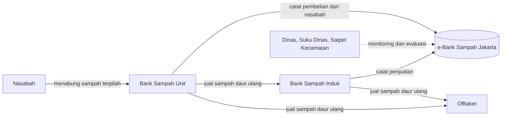

Teks: Nasabah menabung sampah terpilah ke BSU. BSU mencatat pembelian dari nasabah ke e-Bank Sampah Jakarta, lalu menjual sampah daur ulang ke BSI atau langsung ke Offtaker. BSI mencatat penjualan ke sistem dan menjual ke Offtaker. Dinas, Suku Dinas, dan Satpel Kecamatan hanya memantau dan mengevaluasi lewat sistem.

| No | Aktivitas | Pelaku | Data yang dicatat |
| --- | --- | --- | --- |
| 1 | Mendaftar akun, melengkapi biodata (kolom bertanda * wajib), memilih minimal satu bank sampah. Nasabah perorangan wajib mengisi NIK. | Nasabah | Nama, email, jenis nasabah, NIK, nomor HP, alamat lengkap, rekening bank (opsional) |
| 2 | Mendaftar sebagai bank sampah, melengkapi profil dan memilih lokasi pada peta. | BSU atau BSI | Profil, penanggung jawab, badan hukum, luas lahan, status lahan, koordinat |
| 3 | Menetapkan harga sampah per kategori, memilih BSI mitra dan offtaker, mengatur aktivitas serta fasilitas. | BSU, BSI | Kategori sampah dan harga, daftar mitra, aktivitas dan fasilitas |
| 4 | Menimbang sampah dan mencatat transaksi nasabah. | BSU | Tanggal transaksi, petugas, nasabah, jenis sampah, berat (kg) |
| 5 | Mencatat penjualan sampah daur ulang ke BSI atau offtaker. | BSU | Tanggal, tujuan penjualan, jenis sampah, berat (kg) |
| 6 | Mencatat penjualan ke offtaker. | BSI | Tanggal, offtaker, jenis sampah, berat, harga |
| 7 | Mengunduh laporan Excel (transaksi BSI-BSU, nasabah, offtaker) menurut rentang tanggal. | BSU, BSI, pemantau | Laporan hasil rekap |
| 8 | Memantau dan mengevaluasi bank sampah di wilayahnya. | Dinas, Sudin, Satpel | Dashboard total, data bank sampah, nasabah, offtaker |

#### Masukan, proses, dan keluaran

| Masukan | Proses | Keluaran |
| --- | --- | --- |
| Data registrasi nasabah dan bank sampah Harga sampah per kategori Transaksi timbang dan penjualan | Pencatatan jenis, berat, dan volume sampah Konversi menjadi nilai Rupiah Rekapitulasi per nasabah dan per bank sampah | Dashboard nasabah (grafik kg dan Rupiah) Laporan Excel Dashboard pemantau (total BSI, BSU, nasabah, offtaker, berat sampah) Peta lokasi bank sampah |

### 1.4 Fitur menurut peran

| Peran | Menu dan fitur yang dijelaskan panduan |
| --- | --- |
| Nasabah | Dashboard (grafik rekap timbangan, rupiah terkumpul, status aktif), Profile Saya, Bank Sampah Saya (tambah bank sampah), Transaksi Saya |
| BSU | Profil dan status, Data (Nasabah, Bank Sampah Induk, Aktivitas, Harga Sampah, Offtaker), Transaksi (Nasabah, BSI, Offtaker, Laporan) |
| BSI | Profil dan status, Data (BSU, Aktivitas, Harga Sampah, Offtaker), Transaksi (BSU, Offtaker, Laporan) |
| Sudin dan Satpel | Dashboard, Data Bank Sampah, Data Nasabah, Data Offtaker, Laporan Transaksi |
| Dinas | Semua menu pemantau, ditambah Administrasi, Wilayah (kota, kecamatan, kelurahan), dan Master Data |

### 1.5 Kelemahan dan kesenjangan

Tabel berikut membandingkan isi panduan dengan kebutuhan pengelolaan bank sampah tingkat desa. Kolom terakhir menjadi dasar sistem usulan.

| No | Temuan pada sistem berjalan | Dampak | Usulan |
| --- | --- | --- | --- |
| 1 | Nasabah hanya memantau transaksi dan laporan. Menu pengajuan pencairan tabungan tidak ditemukan pada panduan. | Nasabah tidak punya jalur resmi meminta uangnya. Permintaan bergantung komunikasi manual dan sulit dilacak. | Fitur pengajuan pencairan dengan status dan notifikasi. |
| 2 | Akses lewat peramban web. Aplikasi seluler tidak disebut pada panduan. | Kurang praktis bagi warga yang sehari-hari memakai ponsel. | Aplikasi Android untuk nasabah. |
| 3 | Form transaksi nasabah mewajibkan nama nasabah. | Pembelian tunai dari warga yang belum jadi nasabah tidak tercatat, sehingga volume sampah yang dilaporkan lebih kecil dari kenyataan. | Transaksi non-nasabah dengan bayar tunai. |
| 4 | Pemantauan berhenti di Sudin, Satpel Kecamatan, dan Dinas. Tidak ada peran tingkat desa. | Kepala desa tidak punya alat untuk melihat kinerja bank sampah di wilayahnya. | Dashboard kepala desa. |
| 5 | Laporan berupa unduhan Excel. Dashboard pemantau menampilkan angka total. | Tren, komposisi jenis sampah, dan partisipasi per wilayah harus diolah manual. | Dashboard dengan tren mingguan, komposisi, partisipasi per RW, dan catatan tindak lanjut. |
| 6 | Menu stok sampah tidak ditemukan pada panduan. | Sulit mengetahui sampah yang belum terjual dan sulit mendeteksi selisih. | Stok otomatis dari pembelian dikurangi penjualan, penjualan tidak boleh melebihi stok. |
| 7 | Struktur berjenjang (BSU, BSI, offtaker, banyak master data) dirancang untuk skala provinsi. | Beban input dan pelatihan terlalu berat untuk pengelola bank sampah desa. | Sederhanakan menjadi empat peran: nasabah, pengelola, kepala desa, admin. |
| 8 | Menambah jenis sampah harus menghubungi helpdesk. | Katalog jenis dan harga lambat menyesuaikan kondisi pasar. | Admin desa mengelola kategori dan harga sendiri. |

#### Ringkasan dengan kerangka PIECES

| Aspek | Kondisi berjalan | Arah perbaikan |
| --- | --- | --- |
| Performance | Nasabah harus membuka web dan menelusuri menu untuk melihat transaksi. | Saldo langsung tampil di beranda aplikasi. |
| Information | Informasi untuk pemantau berupa total angka dan unduhan Excel. | Dashboard dengan tren dan komposisi. |
| Economics | Pembelian non-nasabah dan pencairan tidak terekam sehingga nilai perputaran tidak utuh. | Semua arus uang tercatat: beli, jual, pencairan. |
| Control | Tidak ditemukan stok dan jejak pencairan pada panduan. | Stok otomatis, status pencairan, dan audit log. |
| Efficiency | Rekap laporan diolah manual. | Laporan dan dashboard dihasilkan otomatis. |
| Service | Nasabah tidak bisa mengajukan atau melacak pencairan. | Pengajuan online dengan notifikasi status. |

## 2. Sistem yang diusulkan

### 2.1 Ringkasan usulan

Sistem usulan bernama **Bank Sampah Digital Desa**. Ada empat perubahan utama dari sistem berjalan:

- **Aplikasi Android untuk nasabah.** Nasabah melihat saldo tabungan, riwayat setoran dan pencairan, lalu mengajukan pencairan langsung dari ponsel.

- **Pembelian dari nasabah maupun non-nasabah.** Pengelola bisa mencatat pembelian dari nasabah (dibayar lewat tabungan atau tunai) dan dari warga yang bukan nasabah (dibayar tunai, identitas tidak wajib).

- **Penjualan ke pengepul.** Pengelola mencatat sampah yang dijual ke pengepul. Stok berkurang otomatis dan penjualan tidak boleh melebihi stok.

- **Dashboard kepala desa.** Kepala desa melihat ringkasan pengelolaan sampah: berat terkumpul, tren, nasabah aktif, komposisi jenis, dan partisipasi per RW.

### 2.2 Aktor dan hak akses

| Fitur | Nasabah | Pengelola | Kepala Desa | Admin |
| --- | --- | --- | --- | --- |
| Login | ✓ | ✓ | ✓ | ✓ |
| Lihat saldo dan riwayat sendiri | ✓ | - | - | - |
| Ajukan pencairan | ✓ | - | - | - |
| Kelola data nasabah | - | ✓ | - | ✓ |
| Catat pembelian (nasabah dan non-nasabah) | - | ✓ | - | - |
| Catat penjualan ke pengepul | - | ✓ | - | - |
| Proses pengajuan pencairan | - | ✓ | - | - |
| Lihat stok | - | ✓ | ✓ | ✓ |
| Kelola kategori dan harga | - | lihat | - | ✓ |
| Kelola akun pengguna | - | - | - | ✓ |
| Laporan transaksi | - | ✓ | ✓ | ✓ |
| Dashboard ringkasan desa | - | lihat | ✓ | ✓ |

### 2.3 Alur proses usulan

**Gambar 2. Alur bisnis sistem usulan.**

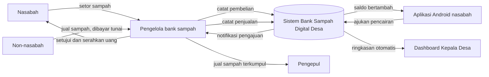

| Proses | Langkah utama |
| --- | --- |
| Pembelian sampah | Penjual datang membawa sampah terpilah. Pengelola memilih jenis penjual (nasabah atau non-nasabah) dan menimbang per jenis. Sistem memakai harga beli aktif dan menghitung total. Nasabah: nilai masuk tabungan atau dibayar tunai. Non-nasabah: dibayar tunai. Stok bertambah dan nasabah menerima notifikasi. |
| Pencairan tabungan | Nasabah mengajukan jumlah dan metode di aplikasi. Sistem memvalidasi lalu menahan sebagian saldo. Pengelola menyetujui atau menolak dengan alasan. Setelah uang diserahkan, pengelola menandai sudah dicairkan dan saldo berkurang. |
| Penjualan ke pengepul | Pengelola memilih pengepul dan jenis serta berat yang dijual. Sistem memeriksa stok dan menghitung total dengan harga jual. Setelah pengepul membayar, pengelola menyimpan transaksi. Stok berkurang dan dashboard diperbarui. |
| Pemantauan desa | Kepala desa membuka dashboard dan memilih periode. Sistem menampilkan angka agregat tanpa data pribadi warga. |

### 2.4 Perbandingan sistem berjalan dan usulan

| Aspek | Sistem berjalan (e-Bank Sampah Jakarta) | Sistem usulan (tingkat desa) |
| --- | --- | --- |
| Platform | Web | Android untuk nasabah, web untuk pengelola, kepala desa, admin |
| Akses nasabah | Memantau transaksi | Memantau saldo, riwayat, dan mengajukan pencairan |
| Sumber pembelian | Nasabah terdaftar | Nasabah dan non-nasabah (tunai) |
| Penjualan | Ke BSI atau offtaker | Ke pengepul, dengan stok dan status pembayaran |
| Stok | Tidak ditemukan pada panduan | Otomatis per jenis sampah |
| Pemantau | Sudin, Satpel, Dinas | Kepala desa (tambahan), data tetap dapat dilaporkan ke atas |
| Bentuk laporan | Unduhan Excel dan total di dashboard | Dashboard tren dan komposisi, serta laporan periodik |
| Kompleksitas | Banyak master data dan jenjang | Empat peran, master data seperlunya |

### 2.5 Aturan bisnis

| Kode | Aturan |
| --- | --- |
| BR-01 | Harga mengikuti harga aktif pada tanggal transaksi. Harga per kg disimpan sebagai salinan di detail transaksi, sehingga perubahan harga tidak mengubah transaksi lama. |
| BR-02 | Pembelian dari nasabah boleh masuk tabungan atau dibayar tunai. Pembelian dari non-nasabah selalu tunai. |
| BR-03 | Saldo = total setoran yang masuk tabungan dikurangi pencairan yang sudah selesai. Saldo tidak boleh negatif. |
| BR-04 | Saldo tersedia = saldo dikurangi pengajuan berstatus DIAJUKAN atau DISETUJUI. |
| BR-05 | Jumlah pencairan minimal sesuai parameter (contoh Rp10.000) dan paling besar sebesar saldo tersedia. |
| BR-06 | Pencairan dianggap selesai hanya setelah pengelola menandainya. Saldo berkurang pada saat itu. |
| BR-07 | Penjualan ke pengepul tidak boleh melebihi stok per jenis sampah. |
| BR-08 | Transaksi tidak dihapus. Kesalahan dikoreksi lewat pembatalan dengan alasan, dan tercatat di audit log. |
| BR-09 | Kepala desa hanya membaca. Dashboard hanya menampilkan data agregat, tanpa nama, NIK, atau nomor HP warga. |
| BR-10 | Nama penjual non-nasabah bersifat opsional. |

## 3. Kebutuhan sistem

Prioritas memakai skala MoSCoW: Must wajib ada pada rilis pertama, **Should** penting, **Could** tambahan bila waktu cukup.

### 3.1 Kebutuhan pemangku kepentingan

| Pemangku kepentingan | Kebutuhan utama |
| --- | --- |
| Nasabah | Tahu saldo kapan saja, meminta uang tabungan tanpa harus bertanya langsung, melihat status permintaan. |
| Pengelola | Mencatat transaksi cepat (kurang dari satu menit), harga terisi otomatis, stok terpantau, tidak perlu rekap manual. |
| Kepala desa | Gambaran ringkas kinerja dan dampak pengelolaan sampah untuk pengambilan keputusan dan laporan musyawarah desa. |
| Admin | Mengatur akun, kategori, dan harga tanpa bergantung pihak lain. |
| Pengepul | Nota penjualan yang jelas (pihak eksternal, tidak login). |

### 3.2 Kebutuhan fungsional

| ID | Modul | Kebutuhan | Prioritas |
| --- | --- | --- | --- |
| FR-01 | Akun | Login dengan nomor HP atau email dan kata sandi, akses dibatasi menurut peran. | Must |
| FR-02 | Akun | Pengelola mendaftarkan nasabah (nama, HP, alamat, RT/RW, nomor anggota) dan membuatkan akun aplikasi. | Must |
| FR-03 | Akun | Pengguna dapat mengubah profil dan kata sandi. | Should |
| FR-04 | Nasabah | Nasabah melihat saldo tabungan dan saldo yang bisa dicairkan. | Must |
| FR-05 | Nasabah | Nasabah melihat riwayat setoran (jenis, berat, nilai) dan pencairan. | Must |
| FR-06 | Nasabah | Nasabah mengajukan pencairan (jumlah, tunai atau transfer). Sistem memvalidasi minimal dan saldo tersedia. | Must |
| FR-07 | Nasabah | Nasabah melihat status pengajuan dan menerima notifikasi saat status berubah. | Must |
| FR-08 | Nasabah | Nasabah membatalkan pengajuan selama masih berstatus DIAJUKAN. | Could |
| FR-09 | Nasabah | Nasabah melihat daftar harga beli sampah yang berlaku. | Should |
| FR-10 | Pengelola | Mencatat pembelian dari nasabah: banyak jenis sampah, harga otomatis, pilihan masuk tabungan atau tunai. | Must |
| FR-11 | Pengelola | Mencatat pembelian dari non-nasabah tanpa registrasi, dibayar tunai. | Must |
| FR-12 | Pengelola | Menampilkan atau membagikan bukti transaksi. | Should |
| FR-13 | Pengelola | Memproses pengajuan pencairan: setujui, tolak dengan alasan, tandai sudah dicairkan. | Must |
| FR-14 | Pengelola | Stok per jenis sampah bertambah saat pembelian dan berkurang saat penjualan. Koreksi stok memerlukan alasan. | Must |
| FR-15 | Pengelola | Mencatat penjualan ke pengepul dengan validasi stok dan status pembayaran. | Must |
| FR-16 | Pengelola | Mengelola data pengepul. | Should |
| FR-17 | Pengelola | Laporan pembelian, penjualan, stok, dan pencairan per periode, dapat diunduh (Excel atau PDF). | Must |
| FR-18 | Pengelola | Membatalkan atau mengoreksi transaksi dengan alasan, tercatat di audit log. | Should |
| FR-19 | Admin | Mengelola kategori sampah serta harga beli dan jual dengan tanggal berlaku. | Must |
| FR-20 | Admin | Mengelola akun pengelola dan kepala desa. | Must |
| FR-21 | Kepala desa | Dashboard: total sampah terkumpul, tren mingguan, nasabah aktif, komposisi jenis, partisipasi per RW, nilai transaksi, penjualan. | Must |
| FR-22 | Kepala desa | Memfilter dashboard menurut periode. | Must |
| FR-23 | Kepala desa | Mengunduh ringkasan (PDF) untuk rapat atau laporan desa. | Should |
| FR-24 | Kepala desa | Catatan tindak lanjut otomatis (stok menumpuk, pencairan tertunda, porsi non-nasabah). | Could |

### 3.3 Kebutuhan non-fungsional

| ID | Aspek | Kebutuhan |
| --- | --- | --- |
| NFR-01 | Keamanan | Semua lalu lintas memakai HTTPS. Kata sandi disimpan sebagai hash (misalnya bcrypt). Akses berbasis peran diperiksa di sisi server. |
| NFR-02 | Privasi | Data pribadi (NIK, nomor HP) dibatasi pada yang diperlukan, NIK dienkripsi, dan pengelolaannya mengikuti UU Pelindungan Data Pribadi. |
| NFR-03 | Integritas data | Transaksi yang mengubah stok dan saldo dijalankan atomik (semua berhasil atau semua dibatalkan). Nominal memakai tipe desimal. |
| NFR-04 | Kinerja | Halaman aplikasi terbuka kurang dari 3 detik pada jaringan 4G. Dashboard tampil kurang dari 5 detik. |
| NFR-05 | Kemudahan pakai | Bahasa Indonesia, huruf terbaca, pencatatan satu transaksi kurang dari 1 menit oleh pengelola terlatih. |
| NFR-06 | Kompatibilitas | Android 8 ke atas. Web responsif pada peramban modern. |
| NFR-07 | Ketersediaan dan cadangan | Target ketersediaan 99%. Cadangan basis data harian. |
| NFR-08 | Auditabilitas | Perubahan penting (harga, pembatalan, koreksi stok, status pencairan) tercatat dengan pelaku dan waktu. |
| NFR-09 | Ketahanan sinyal | Draf transaksi pengelola tidak hilang saat sinyal terputus (prioritas Could). |
| NFR-10 | Skalabilitas | Skema database memuat bank_sampah_id agar dapat menampung lebih dari satu bank sampah atau desa. |

### 3.4 Batasan

- Fase awal tanpa payment gateway. Uang diserahkan di luar sistem.

- Satu bank sampah per desa pada rilis pertama.

- Notifikasi memakai notifikasi dalam aplikasi. Push notification menjadi peningkatan berikutnya.

### 3.5 Rencana validasi kebutuhan

Kebutuhan di atas berasal dari analisis panduan dan uraian usulan Anda. Sebelum dikunci, validasi dengan wawancara singkat: 3 sampai 5 nasabah (apakah saldo dan pencairan lewat ponsel dibutuhkan), pengelola (alur harian dan metode pembayaran), dan kepala desa (angka apa yang paling berguna).

## 4. Use case diagram

**Gambar 3. Use case diagram. Pengepul adalah aktor eksternal: tidak login, hanya menerima nota dan membayar.**

Aktor: Nasabah, Pengelola, Kepala Desa, Admin, Pengepul (eksternal). Semua use case berada di dalam batas sistem "Sistem Bank Sampah Digital Desa".

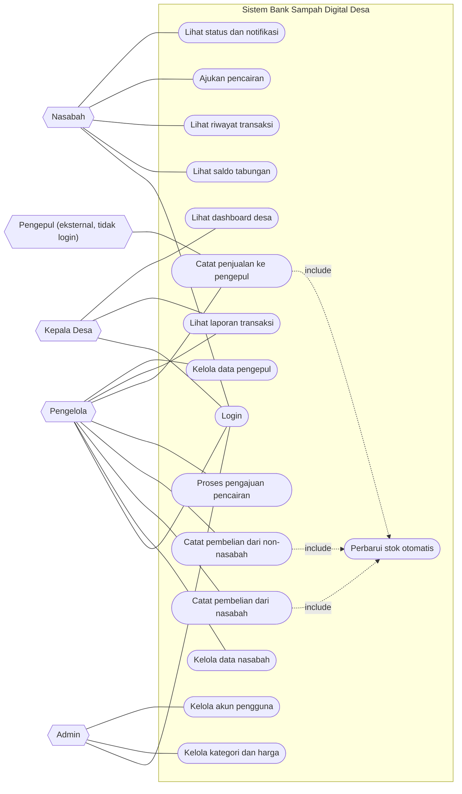

Catatan: pada gambar asli, Admin terhubung ke Login, Kelola kategori dan harga, dan Kelola akun pengguna. Hak akses Admin yang lebih lengkap ada pada tabel di bagian 2.2 (misalnya Admin juga mengelola data nasabah dan melihat laporan, stok, dan dashboard).

### Daftar use case

| ID | Nama | Aktor | Kebutuhan terkait |
| --- | --- | --- | --- |
| UC01 | Login | Semua pengguna | FR-01 |
| UC02, UC03 | Lihat saldo, lihat riwayat | Nasabah | FR-04, FR-05 |
| UC04 | Ajukan pencairan | Nasabah | FR-06 |
| UC05 | Lihat status dan notifikasi | Nasabah | FR-07 |
| UC06 | Kelola data nasabah | Pengelola | FR-02 |
| UC07 | Catat pembelian dari nasabah | Pengelola | FR-10, FR-12 |
| UC08 | Catat pembelian dari non-nasabah | Pengelola | FR-11 |
| UC09 | Proses pengajuan pencairan | Pengelola | FR-13 |
| UC10 | Catat penjualan ke pengepul | Pengelola, Pengepul | FR-15 |
| UC11 | Perbarui stok otomatis | Sistem (di-include) | FR-14 |
| UC12 | Lihat laporan transaksi | Pengelola, Kepala Desa | FR-17 |
| UC13 | Lihat dashboard desa | Kepala Desa | FR-21, FR-22 |
| UC14, UC15 | Kelola kategori dan harga, kelola akun | Admin | FR-19, FR-20 |
| UC16 | Kelola data pengepul | Pengelola | FR-16 |

### Spesifikasi use case utama

| Use case | Prasyarat | Alur utama | Alur alternatif | Hasil |
| --- | --- | --- | --- | --- |
| **UC04** Ajukan pencairan *Aktor: Nasabah* | Nasabah sudah login dan memiliki saldo tersedia. | Nasabah membuka menu Cairkan. Mengisi jumlah dan memilih tunai atau transfer. Menekan Kirim pengajuan. Sistem memvalidasi dan menyimpan pengajuan berstatus DIAJUKAN. | Jumlah di bawah minimal atau melebihi saldo tersedia: sistem menampilkan pesan kesalahan. Metode transfer tanpa rekening: sistem meminta rekening. | Pengajuan tercatat, saldo tersedia berkurang sementara, pengelola menerima notifikasi. |
| **UC07** Catat pembelian dari nasabah *Aktor: Pengelola* | Pengelola login, nasabah terdaftar, harga aktif tersedia. | Pengelola memilih jenis penjual Nasabah lalu memilih nasabah. Menambah jenis sampah dan mengisi berat. Memilih cara bayar (tabungan atau tunai). Menyimpan. Sistem menghitung total, menyimpan transaksi, menambah stok. Jika lewat tabungan, saldo bertambah dan nasabah diberi notifikasi. | Berat kosong: sistem meminta pengisian. Jenis sampah tidak punya harga aktif: sistem menolak dan menyarankan menghubungi admin. | Transaksi tersimpan, stok dan saldo terbarui, bukti transaksi tersedia. |
| **UC08** Catat pembelian dari non-nasabah *Aktor: Pengelola* | Pengelola login. | Pengelola memilih jenis penjual Bukan nasabah. Mengisi nama (opsional), jenis sampah, dan berat. Menyimpan. Sistem menetapkan pembayaran tunai. Pengelola membayar tunai sesuai total. | Sama seperti UC07 untuk kesalahan input. | Transaksi tunai tersimpan dan stok bertambah tanpa mengubah saldo siapa pun. |
| **UC09** Proses pengajuan pencairan *Aktor: Pengelola* | Ada pengajuan berstatus DIAJUKAN. | Pengelola membuka daftar pengajuan dan memeriksa saldo nasabah. Menyetujui (status DISETUJUI). Menyerahkan uang. Menandai sudah dicairkan (status DICAIRKAN). | Ditolak: pengelola memilih alasan, status DITOLAK, saldo tertahan dilepas. Saldo tidak cukup saat ditandai cair: sistem menolak. | Saldo nasabah berkurang, mutasi tercatat, nasabah diberi notifikasi. |
| **UC10** Catat penjualan ke pengepul *Aktor: Pengelola, Pengepul* | Stok tersedia. | Pengelola memilih pengepul, jenis, dan berat. Sistem memeriksa stok dan membuat nota dengan harga jual. Pengepul menimbang dan membayar. Pengelola menyimpan. Stok berkurang. | Berat melebihi stok: sistem menolak dan menampilkan stok yang tersedia. | Transaksi penjualan tersimpan, stok dan dashboard terbarui. |
| **UC13** Lihat dashboard desa *Aktor: Kepala Desa* | Kepala desa login. | Membuka dashboard. Memilih periode (4 atau 12 minggu). Sistem menampilkan angka agregat, grafik, dan catatan tindak lanjut. | Belum ada transaksi pada periode: sistem menampilkan keadaan kosong dengan penjelasan. | Kepala desa mendapat gambaran kinerja tanpa melihat data pribadi. |

## 5. Activity diagram

Diagram dibuat dengan jalur (swimlane) per pelaku. Persegi panjang adalah aktivitas, belah ketupat adalah keputusan.

### 5.1 Pembelian sampah dari nasabah atau non-nasabah

**Gambar 4. Activity diagram pembelian sampah.**

```mermaid
flowchart TD
    subgraph P["Lane: Pengelola"]
        P1([Mulai]) --> P2[Terima sampah dari penjual]
        P2 --> P3{Penjual nasabah?}
        P3 -->|Ya| P4[Pilih nasabah dari daftar]
        P3 -->|Tidak| P5[Isi nama penjual, boleh dikosongkan]
        P4 --> P6[Pilih jenis sampah dan input berat hasil timbangan]
        P5 --> P6
        P6 --> P7[Simpan transaksi]
        P8[Serahkan uang tunai ke penjual] --> P9([Selesai])
    end
    subgraph S["Lane: Sistem"]
        S1[Ambil harga beli aktif dan hitung subtotal] --> S2[Simpan transaksi dan detail]
        S2 --> S3[Tambah stok per jenis sampah]
        S3 --> S4{Nasabah dan dibayar lewat tabungan?}
        S4 -->|Ya| S5[Tambah saldo, catat mutasi, kirim notifikasi]
        S4 -->|Tidak| S6[Tandai pembayaran tunai]
    end
    P7 --> S1
    S5 --> P9
    S6 --> P8
```

### 5.2 Pengajuan dan pencairan tabungan

**Gambar 5. Activity diagram pengajuan dan pencairan.**

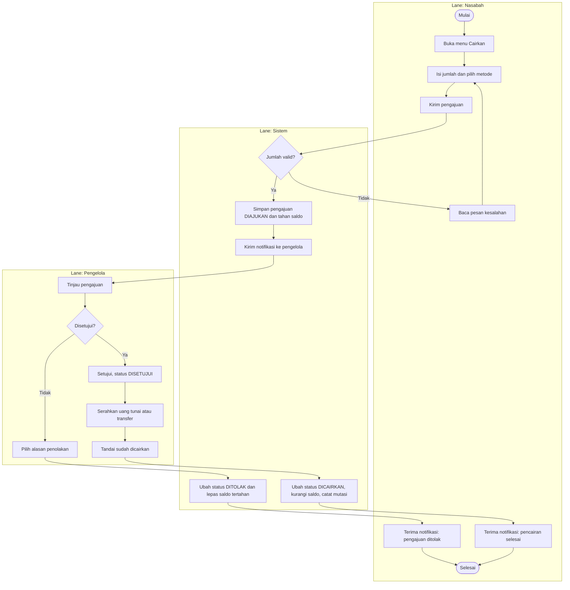

### 5.3 Penjualan sampah ke pengepul

**Gambar 6. Activity diagram penjualan ke pengepul.**

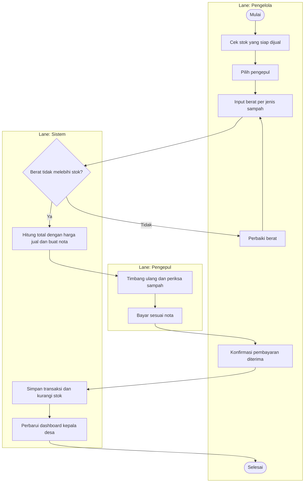

## 6. Sequence diagram

### 6.1 Pembelian sampah

**Gambar 7. Sequence diagram pembelian sampah. Penyimpanan transaksi, stok, dan saldo berjalan dalam satu transaksi database.**

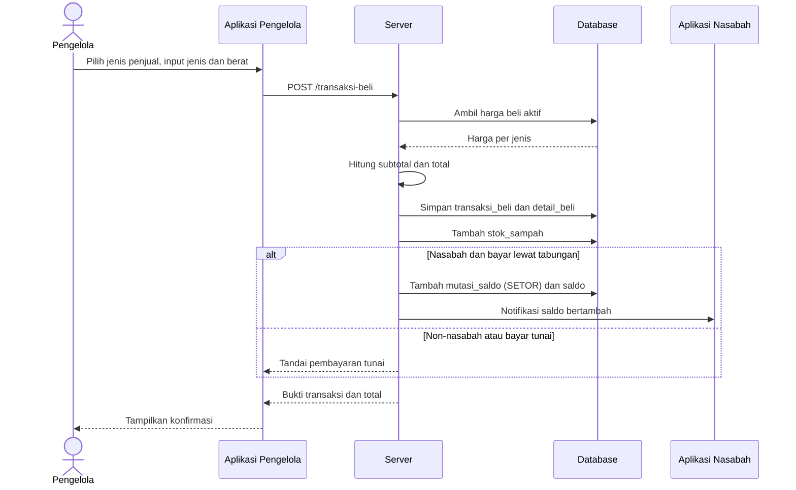

Catatan: penyimpanan transaksi, stok, dan saldo berjalan dalam satu transaksi database.

### 6.2 Pengajuan dan pencairan

**Gambar 8. Sequence diagram pengajuan dan pencairan.**

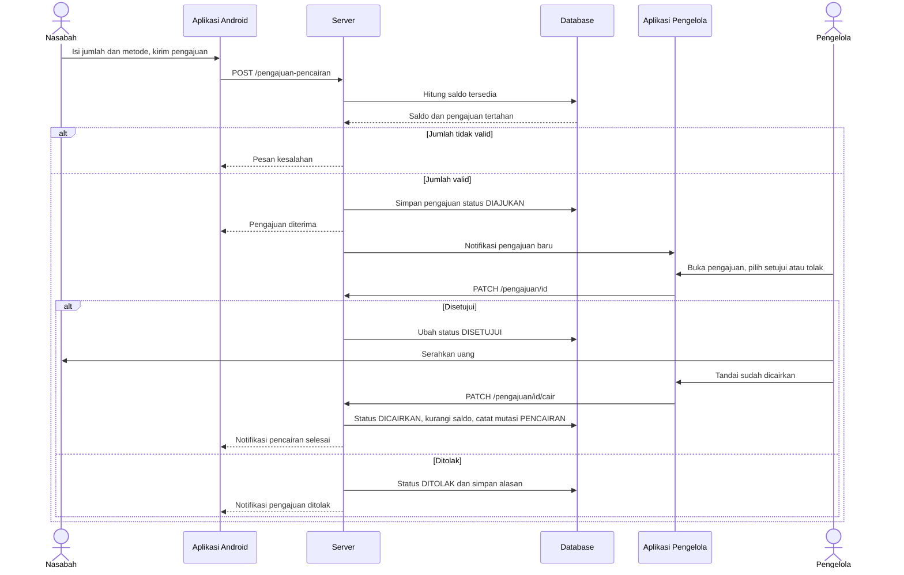

### 6.3 Penjualan ke pengepul

**Gambar 9. Sequence diagram penjualan ke pengepul.**

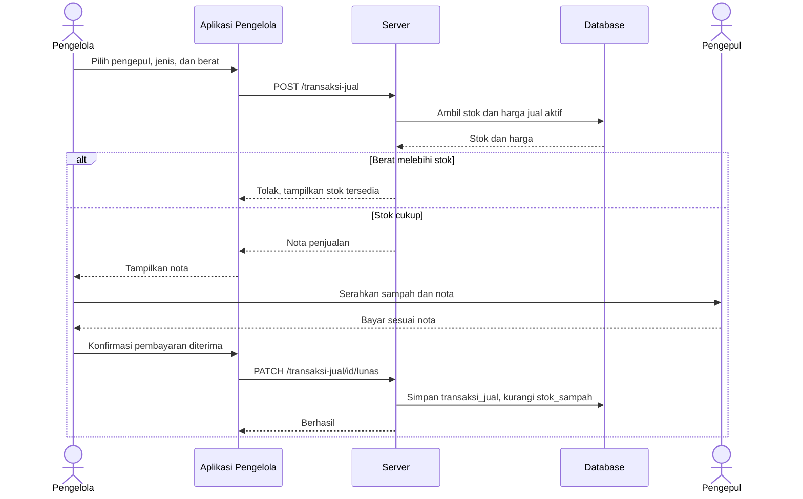

### 6.4 Dashboard kepala desa

**Gambar 10. Sequence diagram dashboard kepala desa.**

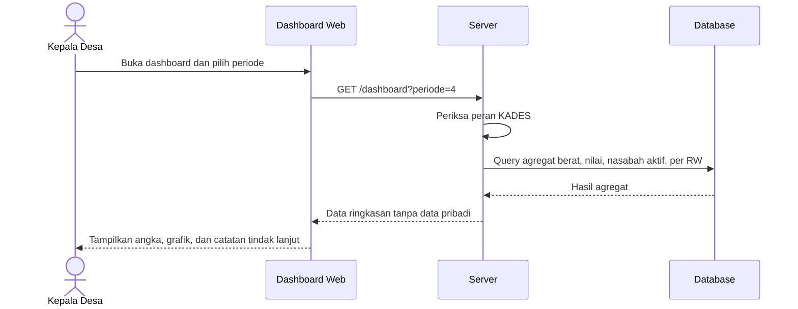

## 7. Struktur database

Basis data relasional (contoh MySQL atau PostgreSQL). Nominal memakai DECIMAL(14,2), berat DECIMAL(10,2). Saldo nasabah disimpan sebagai nilai ringkas di nasabah.saldo dan diperbarui bersama mutasi_saldo dalam satu transaksi database. Buku besar mutasi_saldo menjadi sumber kebenaran bila perlu rekonsiliasi.

### 7.1 Entity relationship diagram

**Gambar 11. ERD. Hanya kunci dan kolom utama yang ditampilkan. Rincian lengkap ada pada kamus data.**

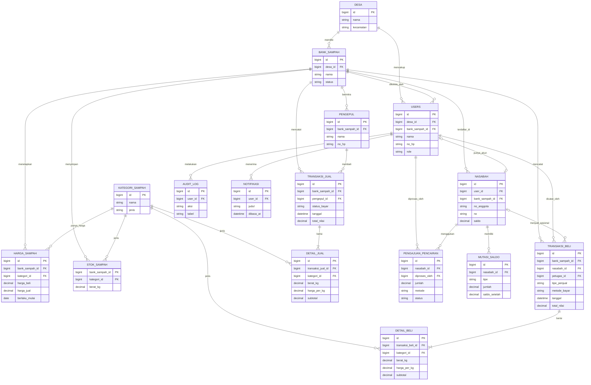

Catatan: yang tampil hanya kunci dan kolom utama. Rincian lengkap kolom ada di kamus data (7.2).

### 7.2 Kamus data

#### Tabel desa — data wilayah desa

| Kolom | Tipe | Keterangan |
| --- | --- | --- |
| id | BIGINT, PK | Identitas desa |
| kode_wilayah | VARCHAR(20) | Kode wilayah resmi |
| nama, kecamatan, kabupaten, provinsi | VARCHAR(100) | Nama wilayah |

#### Tabel bank_sampah — profil bank sampah desa

| Kolom | Tipe | Keterangan |
| --- | --- | --- |
| id | BIGINT, PK |  |
| desa_id | BIGINT, FK desa |  |
| nama, alamat | VARCHAR |  |
| latitude, longitude | DECIMAL(10,7) | Lokasi pada peta |
| penanggung_jawab, no_hp | VARCHAR |  |
| status | ENUM(AKTIF, NONAKTIF) |  |
| created_at | TIMESTAMP |  |

#### Tabel users — akun login semua peran

| Kolom | Tipe | Keterangan |
| --- | --- | --- |
| id | BIGINT, PK |  |
| desa_id | BIGINT, FK desa |  |
| bank_sampah_id | BIGINT, FK, NULL | Terisi untuk pengelola |
| nama | VARCHAR(100) |  |
| no_hp | VARCHAR(20), UNIQUE | Dipakai untuk login |
| email | VARCHAR(100), NULL |  |
| password_hash | VARCHAR(255) | Hash kata sandi |
| role | ENUM(ADMIN, PENGELOLA, KADES, NASABAH) |  |
| status, last_login_at, created_at | ENUM, TIMESTAMP |  |

#### Tabel nasabah — anggota penabung

| Kolom | Tipe | Keterangan |
| --- | --- | --- |
| id | BIGINT, PK |  |
| user_id | BIGINT, FK users, UNIQUE, NULL | Kosong bila belum punya akun aplikasi |
| bank_sampah_id | BIGINT, FK |  |
| no_anggota | VARCHAR(20), UNIQUE | Contoh N-001 |
| nama, no_hp | VARCHAR |  |
| nik | VARCHAR, NULL | Dienkripsi, opsional |
| alamat, rt, rw | VARCHAR | RW dipakai untuk dashboard partisipasi |
| tipe | ENUM(PERORANGAN, INSTANSI) |  |
| nama_bank, no_rekening | VARCHAR, NULL | Untuk pencairan transfer |
| saldo | DECIMAL(14,2), default 0 | Tidak boleh negatif (CHECK) |
| status, tgl_daftar | ENUM, DATE |  |

#### Tabel kategori_sampah — katalog jenis sampah

| Kolom | Tipe | Keterangan |
| --- | --- | --- |
| id | BIGINT, PK |  |
| nama | VARCHAR(100) | Contoh: Botol plastik (PET), Kardus |
| jenis | ENUM(ORGANIK, ANORGANIK) |  |
| satuan | VARCHAR(10), default kg |  |
| aktif | BOOLEAN |  |

#### Tabel harga_sampah — harga beli dan jual berjangka waktu

| Kolom | Tipe | Keterangan |
| --- | --- | --- |
| id | BIGINT, PK |  |
| bank_sampah_id, kategori_id | BIGINT, FK |  |
| harga_beli | DECIMAL(14,2) | Harga per kg dari warga |
| harga_jual | DECIMAL(14,2) | Harga per kg ke pengepul |
| berlaku_mulai | DATE | UNIQUE bersama bank_sampah_id dan kategori_id |
| aktif | BOOLEAN |  |

#### Tabel pengepul — mitra pembeli sampah

| Kolom | Tipe | Keterangan |
| --- | --- | --- |
| id | BIGINT, PK |  |
| bank_sampah_id | BIGINT, FK |  |
| nama, no_hp, alamat | VARCHAR |  |
| status | ENUM(AKTIF, NONAKTIF) |  |

#### Tabel transaksi_beli — kepala transaksi pembelian

| Kolom | Tipe | Keterangan |
| --- | --- | --- |
| id | BIGINT, PK |  |
| no_transaksi | VARCHAR(20), UNIQUE | Contoh TB-0001 |
| bank_sampah_id | BIGINT, FK |  |
| tipe_penjual | ENUM(NASABAH, NON_NASABAH) |  |
| nasabah_id | BIGINT, FK, NULL | Wajib bila NASABAH, kosong bila NON_NASABAH |
| nama_penjual | VARCHAR(100), NULL | Opsional untuk non-nasabah |
| metode_bayar | ENUM(TABUNG, TUNAI) | NON_NASABAH harus TUNAI |
| tanggal | DATETIME |  |
| total_berat, total_nilai | DECIMAL |  |
| petugas_id | BIGINT, FK users | Pengelola yang mencatat |
| status, catatan | ENUM(SAH, BATAL), TEXT | Pembatalan memerlukan alasan |

Aturan CHECK: (tipe_penjual = NASABAH dan nasabah_id tidak kosong) atau (tipe_penjual = NON_NASABAH, nasabah_id kosong, metode_bayar = TUNAI).

#### Tabel detail_beli — rincian jenis sampah per pembelian

| Kolom | Tipe | Keterangan |
| --- | --- | --- |
| id | BIGINT, PK |  |
| transaksi_beli_id | BIGINT, FK |  |
| kategori_id | BIGINT, FK |  |
| berat_kg | DECIMAL(10,2) | Lebih dari 0 |
| harga_per_kg | DECIMAL(14,2) | Salinan harga saat transaksi |
| subtotal | DECIMAL(14,2) | berat_kg dikali harga_per_kg |

#### Tabel transaksi_jual — kepala transaksi penjualan

| Kolom | Tipe | Keterangan |
| --- | --- | --- |
| id | BIGINT, PK |  |
| no_transaksi | VARCHAR(20), UNIQUE | Contoh TJ-0001 |
| bank_sampah_id, pengepul_id, petugas_id | BIGINT, FK |  |
| tanggal | DATETIME |  |
| total_berat, total_nilai | DECIMAL |  |
| status_bayar | ENUM(BELUM, LUNAS) |  |
| status, catatan | ENUM(SAH, BATAL), TEXT |  |

#### Tabel detail_jual — rincian jenis sampah per penjualan

| Kolom | Tipe | Keterangan |
| --- | --- | --- |
| id | BIGINT, PK |  |
| transaksi_jual_id, kategori_id | BIGINT, FK |  |
| berat_kg, harga_per_kg, subtotal | DECIMAL | Sama seperti detail_beli |

#### Tabel stok_sampah — stok per jenis

| Kolom | Tipe | Keterangan |
| --- | --- | --- |
| bank_sampah_id | BIGINT, PK, FK | Kunci gabungan |
| kategori_id | BIGINT, PK, FK | Kunci gabungan |
| berat_kg | DECIMAL(10,2) | Tidak boleh negatif (CHECK) |
| updated_at | TIMESTAMP |  |

#### Tabel mutasi_saldo — buku besar tabungan nasabah

| Kolom | Tipe | Keterangan |
| --- | --- | --- |
| id | BIGINT, PK |  |
| nasabah_id | BIGINT, FK |  |
| tipe | ENUM(SETOR, PENCAIRAN, KOREKSI) |  |
| jumlah | DECIMAL(14,2) | Positif untuk penambahan, negatif untuk pengurangan |
| saldo_setelah | DECIMAL(14,2) | Saldo sesudah mutasi |
| referensi_tipe, referensi_id | ENUM, BIGINT | Menunjuk ke transaksi_beli atau pengajuan_pencairan |
| keterangan, created_at | VARCHAR, TIMESTAMP |  |

#### Tabel pengajuan_pencairan — permintaan pencairan tabungan

| Kolom | Tipe | Keterangan |
| --- | --- | --- |
| id | BIGINT, PK |  |
| no_pengajuan | VARCHAR(20), UNIQUE | Contoh PC-0001 |
| nasabah_id | BIGINT, FK |  |
| jumlah | DECIMAL(14,2) | Minimal sesuai parameter |
| metode | ENUM(TUNAI, TRANSFER) |  |
| tujuan_transfer | VARCHAR(100), NULL | Rekening atau e-wallet |
| status | ENUM(DIAJUKAN, DISETUJUI, DITOLAK, DICAIRKAN, DIBATALKAN) |  |
| alasan_tolak | VARCHAR(200), NULL |  |
| diajukan_at, diproses_at, dicairkan_at | DATETIME, NULL |  |
| diproses_oleh | BIGINT, FK users, NULL |  |

#### Tabel notifikasi — pesan dalam aplikasi

| Kolom | Tipe | Keterangan |
| --- | --- | --- |
| id | BIGINT, PK |  |
| user_id | BIGINT, FK | Penerima |
| judul, isi, tipe | VARCHAR, TEXT |  |
| dibaca_at, created_at | DATETIME, TIMESTAMP | dibaca_at kosong bila belum dibaca |

#### Tabel audit_log — jejak perubahan penting

| Kolom | Tipe | Keterangan |
| --- | --- | --- |
| id | BIGINT, PK |  |
| user_id | BIGINT, FK | Pelaku |
| aksi, tabel, record_id | VARCHAR, BIGINT | Contoh: BATAL, transaksi_beli, 123 |
| sebelum, sesudah | JSON | Nilai lama dan baru |
| created_at | TIMESTAMP |  |

### 7.3 Indeks dan batasan penting

- Indeks pada transaksi_beli(bank_sampah_id, tanggal) dan transaksi_jual(bank_sampah_id, tanggal) untuk laporan dan dashboard.

- Indeks pada pengajuan_pencairan(status, nasabah_id) untuk daftar antrean pengelola.

- Indeks pada mutasi_saldo(nasabah_id, created_at) untuk riwayat nasabah.

- CHECK nasabah.saldo >= 0 dan stok_sampah.berat_kg >= 0 sebagai pengaman terakhir di level database.

- Data dashboard diambil lewat query agregat atau view (misalnya v_rekap_mingguan) sehingga tidak menyentuh kolom data pribadi.

## 8. Wireframe

Wireframe berfidelitas rendah: menunjukkan tata letak dan isi layar, bukan tampilan akhir. Angka bulat kuning merujuk ke keterangan di bawah tiap layar.

### 8.1 Peta navigasi

**Gambar 12. Peta navigasi menurut peran.**

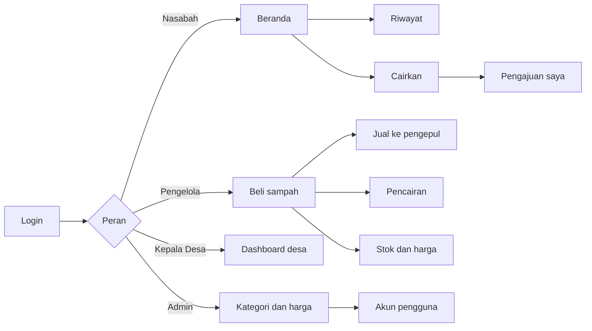

Menu per peran (gambar asli): Nasabah: Beranda, Riwayat, Cairkan, Pengajuan saya. Pengelola: Beli sampah, Jual ke pengepul, Pencairan, Stok dan harga, Laporan. Kepala Desa: Dashboard, Laporan, Stok. Admin: Kategori dan harga, Akun pengguna.

### 8.2 Aplikasi Android nasabah

#### W1. Beranda nasabah

```text
APLIKASI ANDROID, layar Beranda nasabah
+--------------------------------------------------+
| Halo, Sari                              Notif (1)|
| +----------------------------------------------+ |
| | Saldo tabungan sampah                        | |
| | Rp 000.000                                   | |
| +----------------------------------------------+ |
| [ Ajukan pencairan ] (2)                         |
| +--------------------+  +---------------------+  |
| | 00,0 kg bulan ini  |  | 00 setoran          |  |
| +--------------------+  +---------------------+  |
| Pengajuan terakhir                               |
| +----------------------------------------------+ |
| | Rp 50.000                    [Menunggu] (3)  | |
| +----------------------------------------------+ |
| Aktivitas terbaru                                |
|   (baris setoran) ............................ +Rp 0 |
|   (baris setoran) ............................ +Rp 0 |
|--------------------------------------------------|
| [Beranda]        [Riwayat]        [Cairkan]      |
+--------------------------------------------------+
```

Keterangan nomor pada wireframe:

1. Ikon notifikasi: setoran baru dan perubahan status pengajuan.

2. Pintasan ke formulir pencairan.

3. Status pengajuan terakhir: Menunggu, Disetujui, Dicairkan, atau Ditolak.

#### W2. Ajukan pencairan

```text
APLIKASI ANDROID, layar Ajukan pencairan
+--------------------------------------------------+
| Cairkan tabungan                                 |
| +----------------------------------------------+ |
| | Saldo yang bisa dicairkan               (1)  | |
| | Rp 000.000                                   | |
| +----------------------------------------------+ |
| Jumlah (Rp)                                      |
| [ Contoh: 50000                               ]  |
| [ Cairkan semua ] (2)                            |
| (o) Ambil tunai di bank sampah                   |
| ( ) Transfer rekening / e-wallet            (3)  |
| [          Kirim pengajuan                    ]  |
| Pengajuan saya                                   |
|   (baris pengajuan)                  [Dicairkan] |
|--------------------------------------------------|
| [Beranda]        [Riwayat]        [Cairkan*]     |
+--------------------------------------------------+
```

Keterangan nomor pada wireframe:

1. Saldo tersedia sudah dikurangi pengajuan yang masih berjalan.

2. Mengisi jumlah maksimal secara otomatis.

3. Kolom rekening muncul hanya jika metode transfer dipilih.

### 8.3 Web pengelola

#### W3. Pengelola — catat pembelian sampah

```text
WEB PENGELOLA: /pengelola/beli-sampah
+---------------+----------------------------------------------------+
| > Beli sampah | Catat pembelian sampah                             |
|   Jual ke     | [Nasabah*] [Bukan nasabah] (1)                     |
|   pengepul    | Nasabah                    Cara bayar              |
|   Pencairan   | [Pilih nasabah (2)]        [Masuk tabungan (3)]    |
|   Stok & harga| +--------------+----------+-----------+----------+ |
|   Laporan     | | Jenis sampah | Berat kg | Harga/kg  | Subtotal | |
|               | | Botol plastik| 0,0      | Otomatis  | Rp 0     | |
|               | | Kardus       | 0,0      | Otomatis  | Rp 0     | |
|               | +--------------+----------+-----------+----------+ |
|               | [Tambah jenis]                 Total: Rp 000.000   |
|               | [Simpan transaksi] (4)                             |
+---------------+----------------------------------------------------+
```

Keterangan nomor pada wireframe:

1. Pilihan jenis penjual: nasabah atau bukan nasabah.

2. Untuk nasabah, saldo saat ini ditampilkan. Untuk bukan nasabah, kolom ini menjadi nama penjual (opsional).

3. Bukan nasabah dikunci pada pembayaran tunai.

4. Setelah disimpan, muncul konfirmasi dan bukti transaksi.

#### W4. Pengelola — catat penjualan ke pengepul

```text
WEB PENGELOLA: /pengelola/jual-ke-pengepul
+---------------+----------------------------------------------------------+
|   Beli sampah | Catat penjualan ke pengepul                              |
| > Jual ke     | Pengepul: [Pilih pengepul]                               |
|   pengepul    | +--------------+---------+--------------+-----------+---------+
|   Pencairan   | | Jenis sampah | Stok    | Berat dijual | Harga     | Subtotal|
|   Stok & harga| | Botol plastik| 00,0 kg | 0,0          | Otomatis  | Rp 0    | (1)
|   Laporan     | | Kardus       | 00,0 kg | 0,0          | Otomatis  | Rp 0    |
|               | +--------------+---------+--------------+-----------+---------+
|               | [Tambah jenis]                       Total: Rp 000.000   |
|               | [Simpan penjualan] (2)                                   |
+---------------+----------------------------------------------------------+
```

Keterangan nomor pada wireframe:

1. Stok tiap jenis ditampilkan di samping isian berat. Melebihi stok akan ditolak.

2. Menyimpan mengurangi stok dan memperbarui dashboard.

#### W5. Pengelola — daftar pengajuan pencairan

```text
WEB PENGELOLA: /pengelola/pencairan
+---------------+---------------------------------------------------------------+
|   Beli sampah | Pengajuan pencairan                                           |
|   Jual ke     | +---------+-----------+--------+----------+-----------+-----------------+
|   pengepul    | | Nasabah | Diajukan  | Jumlah | Metode   | Status    | Aksi            |
| > Pencairan   | | Nama    | 00 Sep    | Rp 0   | Tunai    | Menunggu  | Setujui / Tolak | (1)
|   Stok & harga| | Nama    | 00 Sep    | Rp 0   | Transfer | Disetujui | Tandai dicairkan|
|   Laporan     | | Nama    | 00 Sep    | Rp 0   | Tunai    | Dicairkan | -               |
|               | +---------+-----------+--------+----------+-----------+-----------------+
|               | Menolak meminta alasan; menandai dicairkan mengurangi saldo nasabah.     |
+---------------+---------------------------------------------------------------+
```

Keterangan nomor pada wireframe:

1. Menolak meminta alasan yang akan terlihat oleh nasabah.

2. Tombol ini dipakai setelah uang diserahkan. Saldo berkurang saat ditekan.

### 8.4 Dashboard kepala desa

#### W6. Dashboard kepala desa

```text
WEB KEPALA DESA: /dashboard
+-----------+------------------------------------------------------------+
| > Dashboard| [4 minggu*] [12 minggu] (1)             Akses: hanya lihat |
|   Laporan  | +-----------------------------------+ +------------------+ |
|   Stok     | | Sampah terkumpul             (2)  | | Nasabah aktif:   | |
|            | | 000 kg   naik 00%                 | | 0 dari 0    (3)  | |
|            | | [grafik batang mingguan]          | | Nilai dibeli dari| |
|            | |                                   | |   warga          | |
|            | +-----------------------------------+ | Hasil penjualan  | |
|            |                                       | Total saldo      | |
|            |                                       |   tabungan       | |
|            | +----------------------+ +-----------------------------+   |
|            | | Jenis sampah terbanyak| | Partisipasi per RW     (4) |   |
|            | +----------------------+ +-----------------------------+   |
|            | +------------------------------------------------------+   |
|            | | Catatan untuk tindak lanjut                      (5) |   |
|            | +------------------------------------------------------+   |
+-----------+------------------------------------------------------------+
```

Keterangan nomor pada wireframe:

1. Filter periode dan label akses hanya lihat.

2. Angka utama beserta perbandingan dengan periode sebelumnya dan grafik mingguan.

3. Ringkasan angka pendukung, semuanya agregat.

4. Partisipasi tiap RW: jumlah nasabah aktif dan berat sampah.

5. Catatan otomatis: pencairan menunggu, stok belum terjual, porsi non-nasabah.

## 9. Prototipe

Prototipe interaktif dapat dibuka di peramban tanpa instalasi. Data awal adalah data contoh yang dibangkitkan otomatis untuk desa fiktif "Sukamaju", dan tidak tersimpan permanen (tombol Atur ulang data mengembalikan ke keadaan awal).

### 9.1 Isi prototipe

| Peran di prototipe | Yang bisa dicoba | Kebutuhan terkait |
| --- | --- | --- |
| Nasabah (tampilan Android) | Beranda dengan saldo, riwayat setoran dan pencairan, formulir pengajuan dengan validasi, status pengajuan. | FR-04 sampai FR-07 |
| Pengelola, Beli sampah | Mencatat pembelian dari nasabah (tabungan atau tunai) dan dari non-nasabah (tunai). Harga terisi otomatis, total dihitung langsung. | FR-10, FR-11, FR-14 |
| Pengelola, Jual ke pengepul | Mencatat penjualan dengan validasi stok. | FR-14, FR-15 |
| Pengelola, Pencairan | Menyetujui, menolak dengan alasan, menandai sudah dicairkan. | FR-13 |
| Pengelola, Stok dan harga | Stok per jenis dan harga beli serta jual. | FR-14, FR-19 (tampilan) |
| Kepala Desa | Dashboard dengan pilihan periode, tren mingguan, jenis sampah, partisipasi per RW, catatan tindak lanjut. | FR-21, FR-22, FR-24 |

### 9.2 Skenario uji

- Buka peran **Nasabah** dan catat saldo Sari Wulandari di beranda.

- Pindah ke **Pengelola**, tab Beli sampah. Pilih nasabah N-001, isi berat, simpan. Coba juga pilih "Bukan nasabah" dan lihat cara bayar terkunci tunai.

- Kembali ke **Nasabah**: saldo bertambah dan setoran muncul di riwayat.

- Buka tab Cairkan, ajukan pencairan. Coba jumlah di bawah Rp10.000 atau melebihi saldo untuk melihat validasi.

- Pindah ke **Pengelola**, tab Pencairan: setujui, lalu tandai sudah dicairkan. Coba juga menolak pengajuan lain.

- Pada tab Jual ke pengepul, jual sebagian stok. Coba berat yang melebihi stok.

- Buka **Kepala Desa** dan lihat angka pada dashboard ikut berubah.

### 9.3 Batas prototipe

- Belum ada login, basis data, dan notifikasi nyata. Semua logika berjalan di peramban.

- Pengelolaan akun, kategori, dan harga oleh admin belum dibuat. Harga bersifat tetap.

- Tampilan nasabah menyerupai aplikasi Android, tetapi bukan aplikasi native.

Dokumen dibuat berdasarkan Buku Panduan e-Bank Sampah Jakarta 2024 (Dinas Lingkungan Hidup Provinsi DKI Jakarta). Rancangan sistem usulan adalah proposal dan perlu divalidasi dengan pengguna sebelum dikembangkan.

1